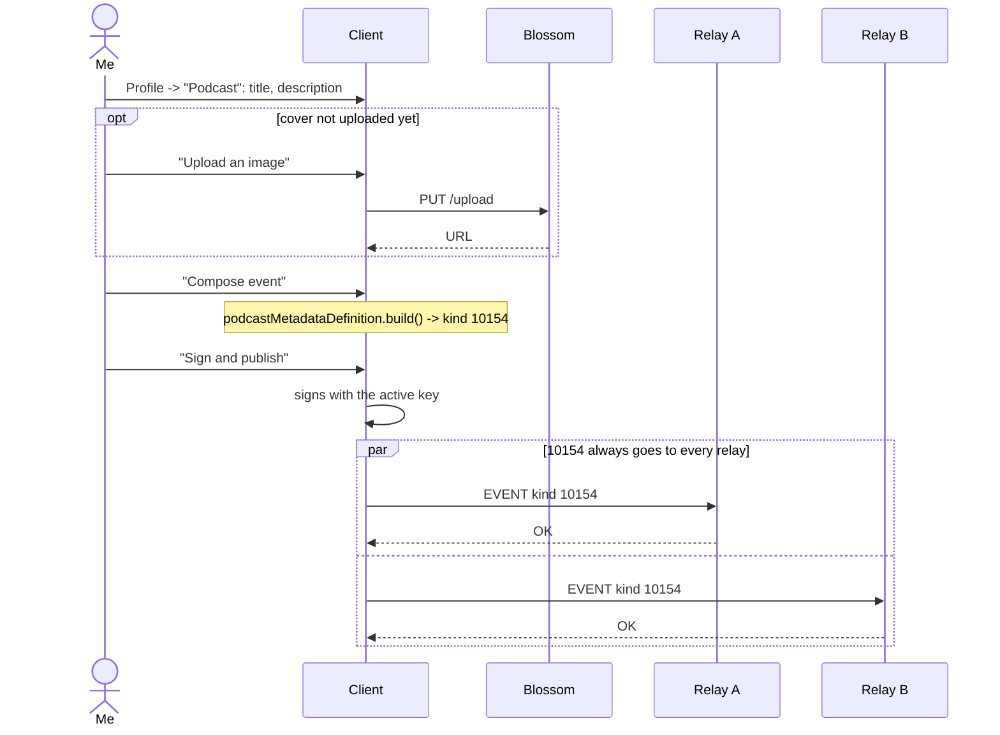
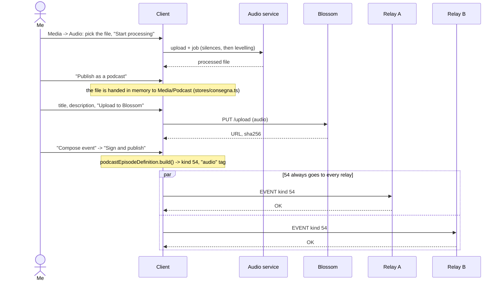
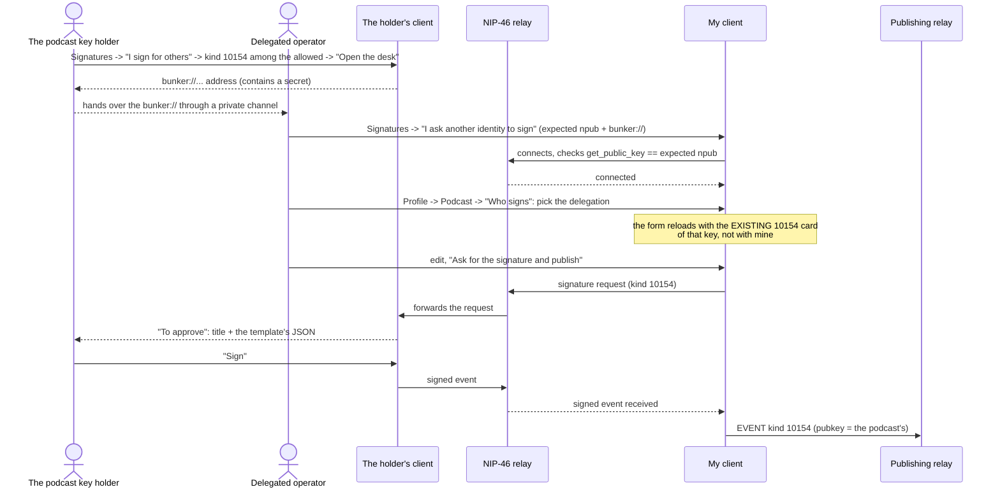
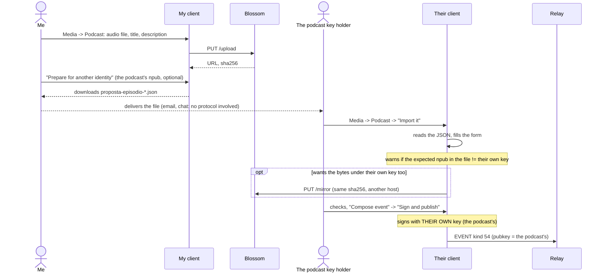
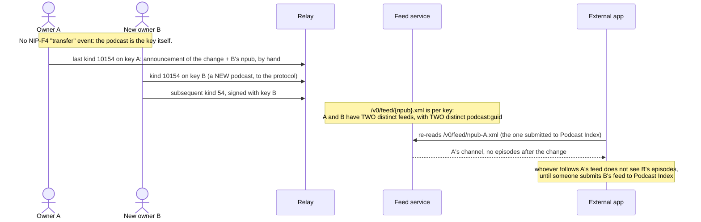

# Podcasts on Nostr (NIP-F4): the client's guide

What the client can do today with kinds 54, 10154 and 10064, and how the six
cases that actually matter behave: publishing a podcast or an episode of your
own, publishing one that is not yours, doing it on behalf of a third party,
and — the case the protocol does not provide for — transferring ownership.

This is not a step-by-step tutorial about buttons: the UI itself covers that,
explaining every choice where the choice is made. This document is for
whoever needs to understand **how the pieces fit together**, and where they
stop fitting.

## The model: why a podcast is a key

NIP-F4 has no concept of a "show" separate from a Nostr identity: **every
podcast is a key pair of its own**. Publishing an episode with your personal
identity means that identity _becomes_ the podcast — there is no intermediate
layer, there is no "published on behalf of" field. Whoever signs the event
is, as far as the protocol is concerned, the author.

That design choice has a consequence that runs through the rest of this
document: **everything that looks like "running a podcast together with other
people" or "handing it over" is a signing problem**, not a data problem. The
question to ask, in every use case, is always the same: _which key must appear
as the `pubkey` on the event, and how do we get that key to be the signer?_

## The three kinds

| Kind      | NIP-F4 name         | Class               | What it says                                                                                      | File                                                                    |
| --------- | ------------------- | ------------------- | ------------------------------------------------------------------------------------------------- | ----------------------------------------------------------------------- |
| **54**    | podcast episode     | regular (immutable) | one episode: title, description, image, one or more `audio` sources (url + MIME, **not** `imeta`) | [`podcast.ts`](../packages/nostr-core/src/kinds/definitions/podcast.ts) |
| **10154** | podcast card        | replaceable         | the _show_ card: title, description, image, websites, declared authors (`p` with a role)          | same file                                                               |
| **10064** | podcasts you author | replaceable         | published by the **author**, on **their** key: lists the shows they claim to work on              | same file                                                               |

10154 and 10064 are the two halves of the same corroboration: 10154 says
_"these are my authors"_, 10064 says _"I work on this show"_. NIP-F4 says so
explicitly — a podcast can attribute anyone it likes in its `p` tags, so that
list alone proves nothing; it is the 10064, published by the author on their
own key, that gives independent corroboration.

Three constraints the client enforces, worth knowing before reading the use
cases:

- **description and image are mandatory**, both for the episode and for the
  card — NIP-F4 does not require them to the letter, but without them there is
  nothing for a podcast player to show, and the client asks for them rather
  than letting the error come back from a relay.
- **audio is declared with the `audio` tag, not with `imeta`**: no hash, no
  size. A listener cannot verify that the file is the one that was published —
  the specification wants it that way, and the client says so on the page
  instead of silently correcting it.
- **10154 and 10064 always go to every write relay**, whatever strategy you
  picked in the settings — unlike notes. A podcast player reads from a relay
  of its own and does not ask the client where it published: if the card ends
  up on a single relay, then for anyone reading from another relay the podcast
  simply does not exist. The rule lives in the core
  (`strategiaPerKind`, [`relays/publish.ts`](../packages/nostr-core/src/relays/publish.ts))
  and holds for the profile and the other lists too.

## Where it happens, in the client

| What                                           | Page                                  | Kind involved                               |
| ---------------------------------------------- | ------------------------------------- | ------------------------------------------- |
| Podcast card (your own identity)               | _Profile → Podcast_                   | 10154                                       |
| "I am an author of this podcast"               | _Profile → Podcasts I author_         | 10064                                       |
| Pre-processing audio (silences, levelling)     | _Media → Audio_                       | — (publishes nothing by itself)             |
| Uploading and publishing an episode            | _Media → Podcast_                     | 54                                          |
| Episode drafts left half-finished              | _Media → Podcast_ (list at the top)   | 54                                          |
| Granting/asking for a delegated signature      | _Signatures_                          | any delegable kind, 54 and 10154 by default |
| Checking the RSS feed and downloading the OPML | _Profile → RSS feed_ (under the card) | derived from 54 + 10154                     |

## Two ways to have another key sign

Every use case involving more than one identity goes through one of these two
mechanisms. They are not interchangeable: they solve different situations.

|                        | Exportable proposal                                                                                                                                                   | NIP-46 delegation                                                                                                                                                                 |
| ---------------------- | --------------------------------------------------------------------------------------------------------------------------------------------------------------------- | --------------------------------------------------------------------------------------------------------------------------------------------------------------------------------- |
| **Model**              | A JSON file: the form data plus descriptors of files already on Blossom. It is not an event, it is not signed.                                                        | A real remote _bunker_: whoever holds the key opens a session listening on a meeting relay.                                                                                       |
| **Timing**             | Asynchronous: you download it, deliver it over any channel (email, chat), and import it whenever.                                                                     | Synchronous: the one asking for the signature and the one granting it must both have the client open at the same time (the request expires after 3 minutes).                      |
| **Who actually signs** | Whoever **imports** the JSON: they rebuild from the form what they can see and sign with their own session. They never receive an event pre-packaged by someone else. | Whoever holds the key, from the _desk_ — approving or refusing each request, event by event.                                                                                      |
| **Which kinds**        | Only **54** (episode): `esportaProposta` / `importaProposta` live in the "podcast" mode of _Media → Podcast_.                                                         | The ones chosen at the desk. 54 and 10154 by default ([`KIND_RICHIESTI`](../apps/web/app/stores/deleghe.ts), [`KIND_PREDEFINITI`](../apps/web/app/stores/banco.ts)).              |
| **Revocable**          | N/A — it is a file, not a permission.                                                                                                                                 | Yes: the key holder closes the desk or stops approving from then on.                                                                                                              |
| **Files**              | [`episodi/index.ts`](../packages/nostr-core/src/episodi/index.ts) (`BozzaEpisodio`), UI in [`CaricaMedia.vue`](../apps/web/app/components/media/CaricaMedia.vue)      | [`signers/{bunker,delega}.ts`](../packages/nostr-core/src/signers/), UI in [`firme.vue`](../apps/web/app/pages/firme.vue), [`stores/{banco,deleghe}.ts`](../apps/web/app/stores/) |

Note the row that is missing: **there is no exportable proposal for 10154**.
Updating the card of a podcast you do not own is possible _only_ by
delegation, never asynchronously. It is listed at the end, among the things
not covered.

---

## Case 1 — Publishing a podcast of my own

The simplest shape: the show card on your own identity.



Publishing again (`Compose event` once more, with different data)
**replaces** the previous version: 10154 is replaceable, it does not pile up.

## Case 2 — Publishing an episode of my own

The whole path, with audio pre-processing as an optional but integrated step:
the processed audio arrives in the right place without downloading and
re-uploading it by hand.



You can also start straight from _Media → Podcast_ with a file that is already
ready, skipping the Audio page. And at any point before "Compose event",
**"Save as draft"** puts the work away — useful when a piece is still
missing, typically the episode image.

## Case 3 — Publishing someone else's podcast

"Someone else's" here means: the card (10154) has to go out with the `pubkey`
of an identity whose private key I do **not** hold. The only way the client
offers is NIP-46 delegation — there is no exportable proposal for this kind.



One detail that matters: choosing the delegation in _Profile → Podcast_, the
form **does not start empty and does not start from my profile** — it goes
looking on the relays for the last card published by that key
(`perCoordinata(10154, undefined, pubkeyDelegata)`) and loads it for editing.
If that key has no card yet, the form is empty and the first publication
creates it.

## Case 4 — Publishing someone else's episode

The same question as case 3, applied to kind 54. Here, though, the
asynchronous path also exists, and that is the one shown: whoever prepares the
episode does not have to be online at the same time as the key holder.



The synchronous alternative exists and is, in outline, identical to case 3:
from _Media → Podcast_, with an active delegation, the "Who signs" field
appears and the button becomes "Ask for the signature and publish". You pick
one or the other depending on whether the key holder is reachable at the same
moment.

## Case 5 — Publishing someone else's episode on behalf of someone else

Here there are **three** actors: whoever provides the material (a person who
may not use this client at all — a guest who emails an audio file), whoever
uploads and packages it, and whoever holds the podcast key and signs.
Technically it is the same mechanism as case 4; the difference is that
"prepares" and "wants it published" are two different people.

```mermaid
sequenceDiagram
    actor Requester as Person B
    actor Operator as Me
    participant MyClient as My client
    participant Blossom
    actor Holder as The podcast key holder
    participant TheirClient as Their client
    participant Relay

    Requester-->>Operator: audio file and notes, over any channel
    Operator->>MyClient: Media -> Podcast: upload, title, description
    MyClient->>Blossom: PUT /upload
    Blossom-->>MyClient: URL, sha256
    Operator->>MyClient: "Prepare for another identity" (the podcast's npub)
    Note over MyClient: preparataDa = MY npub (whoever packaged it).<br/>The link to B stays informal: it does not enter the signed event.
    MyClient-->>Operator: proposta-episodio-*.json
    Operator-->>Holder: delivers the proposal
    Holder->>TheirClient: "Import it", checks, "Sign and publish"
    TheirClient->>Relay: EVENT kind 54 (pubkey = the podcast's; no reference to B)
```

**Being straight about something that matters**: the proposal's `preparataDa`
field is informational and local — it lives in the JSON file, not in the
published event, and it records who _packaged_ the proposal (the operator),
not who _provided_ the original content (Person B). If credit to B has to
appear somewhere verifiable, the only place the protocol offers is inside the
episode's own content (the `content`, in Markdown) or, if B works on the show
regularly, as an author in the 10154 — corroborated by their 10064. There is
no automatic way to say "published by X on behalf of Y" on Nostr, because an
event has exactly one `pubkey`.

## Case 6 — Transferring ownership of a podcast

Here the honest answer is: **NIP-F4 does not provide for it**, because there
is nothing to transfer at the data level — the podcast _is_ the key, and a key
is either yours or it is not. There is no "ownership changed" event, nor a
"moved to" tag as there is for other uses on Nostr. The client cannot invent a
mechanism the protocol does not have; it can only be clear about the three
real paths, and what each one costs.

| Option                                         | What happens                                                                          | Reversible                                                                                                                | RSS feed continuity                               | When it makes sense                                                                                                                              |
| ---------------------------------------------- | ------------------------------------------------------------------------------------- | ------------------------------------------------------------------------------------------------------------------------- | ------------------------------------------------- | ------------------------------------------------------------------------------------------------------------------------------------------------ |
| **Handing over the nsec**                      | The new owner receives the private key and publishes as if it had always been theirs  | **No.** Whoever held it before _can always_ publish with that key again: handing it over does not revoke it, it copies it | Total — same npub, same feed, same `podcast:guid` | Complete trust and a final exit by whoever is handing over                                                                                       |
| **NIP-46 delegation** (what the client offers) | The old owner keeps the key and grants a signing delegation to whoever operates       | **Yes** — they close the desk or stop approving whenever they want                                                        | Total                                             | This is an _operational_ handover, not a real transfer. The right case when the owner wants to stay responsible but no longer run the day to day |
| **Key rotation**                               | A new identity is born; as far as the protocol is concerned it is a different podcast | There is no "going back": it is a choice, not a rollback                                                                  | **None, automatically**                           | A deliberate clean break, or an old key that has been compromised                                                                                |

Rotation is the option with the least obvious consequences, because this
client's RSS feed is **tied to the npub** (`/v0/feed/{npub}.xml`,
[`urlFeedPodcast`](../packages/nostr-core/src/feed/index.ts)): changing key
changes the feed address, and none of the external directories learns that by
itself.



With no standard tag for the announcement, the practical way is to put it by
hand in the `description` of A's final 10154 and in a kind 1 that links to it:
it is a convention, not a mechanism — and whoever does it should be told, not
left to find out when the listeners disappear.

---

## The RSS feed: the same story seen from outside Nostr

The feed (_Profile → RSS feed_, under the podcast card) is not a seventh use
case: it is a **read-only projection** of a key's kind 54 and 10154 events,
generated by an external service (not by this client — see
[`doc/api-to-build.md`](../doc/api-to-build.md), Prompts F/G) because neither
GitHub Pages nor Blossom can serve a stable URL. It is worth repeating here
because all six cases above are its source: **whichever identity publishes the
episode or the card — your own, delegated, by proposal — it ends up in the
same feed**, the one of the npub that appears as the `pubkey` on the event.
The feed neither knows nor cares _how_ that event was composed; it only knows
whose signature is on it.

The "RSS feed" card verifies the feed by actually downloading it and compares
the episodes it contains with the ones the client sees on the relays: if
something is missing, either a relay was slow when the service built the feed
(which it keeps a copy of for a few minutes), or the event ended up on a relay
the service does not read from — the same "every relay for a podcast" rule
explained above. For the second case there is «Redistribute to the relays», in
that card and in the podcast card: it sends the card and the episodes, already
signed, to every write relay.

## The tags we do not know, and the `client` tag

Every event that leaves here carries `["client", "NostrMediaClient"]`
(NIP-89): it says what composed it, and it replaces another client's name when
you republish an event read elsewhere — because that new event is written by
this program.

The other side of the same choice: **editing an event does not delete what the
form cannot represent**. When a published event is reopened, the tags the kind
does not write — another client's, or the ones our form does not pass on yet —
land in the «Tags» section at the bottom of the form, where they can be
corrected or removed by hand, and they go back out with the republished event.
This holds for the podcast card (10154) as for the other replaceable kinds.
That section is also where free tags are added, for whatever the client does
not provide for.

## What is not covered today

Honesty, not a list of excuses — so that whoever designs the next step knows
where they are starting from:

- **No asynchronous proposal for 10154.** Updating someone else's podcast card
  is only possible through NIP-46 delegation, never offline. Anyone who wants
  to propose a change to the card without being online together with the owner
  has no path in the client today.
- **10064 has no card of its own.** `KindRenderer.vue` has no branch for
  `renderer: 'podcast-authored'`: it falls back to the raw rendering
  (`EventRawCard`) instead of a readable card. It is not broken — that is the
  intended fallback for kinds without a renderer — but it is less clear than
  it could be.
- **No ownership transfer at the protocol level**, for the reasons in case 6:
  that is a NIP-F4 limit, not the client's.
- **Revoking a 10064 is not guaranteed.** Publishing it empty is forbidden by
  `build()` on purpose (an empty list makes no sense: it would remove the only
  signal it carries); the only path is a deletion request (kind 5), which
  relays may ignore.
- **No warning, in the client, when you are about to rotate the key of a
  podcast** that already has published episodes: nothing intercepts it,
  because "rotating the key" is, to the client, simply "using a different
  identity", indistinguishable from any other key change.

## References

- [NIP-F4](https://github.com/nostr-protocol/nips/blob/podcasts/54.md) — the
  specification: kinds 54 and 10154, and the related kind 10064.
- [`packages/nostr-core/src/kinds/definitions/podcast.ts`](../packages/nostr-core/src/kinds/definitions/podcast.ts) —
  the three definitions, with tests in
  [`podcast-allegati.test.ts`](../packages/nostr-core/test/podcast-allegati.test.ts).
- [`packages/nostr-core/src/episodi/index.ts`](../packages/nostr-core/src/episodi/index.ts) —
  the episode draft/proposal, with [`episodi.test.ts`](../packages/nostr-core/test/episodi.test.ts).
- [`packages/nostr-core/src/signers/`](../packages/nostr-core/src/signers/) —
  NIP-46 desk and delegation, with [`firma-delegata.test.ts`](../packages/nostr-core/test/firma-delegata.test.ts).
- [`packages/nostr-core/src/feed/index.ts`](../packages/nostr-core/src/feed/index.ts) —
  reading and verifying the feed, OPML generator, with [`feed.test.ts`](../packages/nostr-core/test/feed.test.ts).
- [`doc/api-to-build.md`](../doc/api-to-build.md) — the prompts for the
  external service (audio domain, feed domain).
